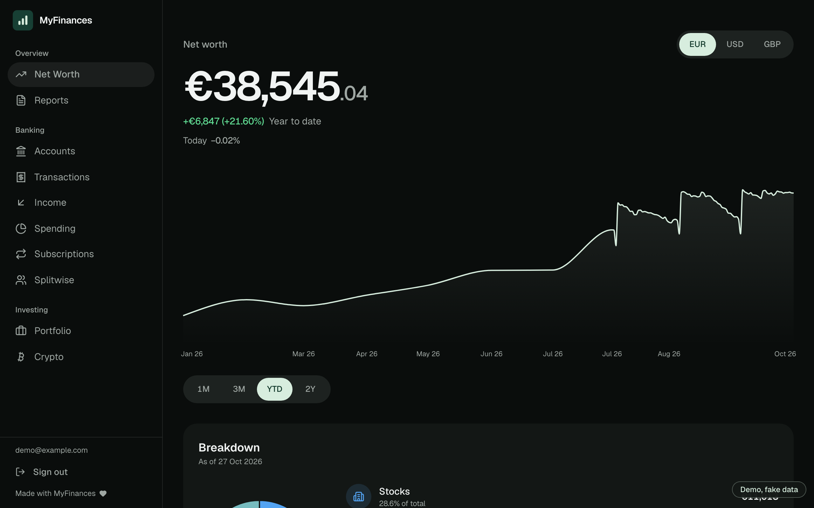
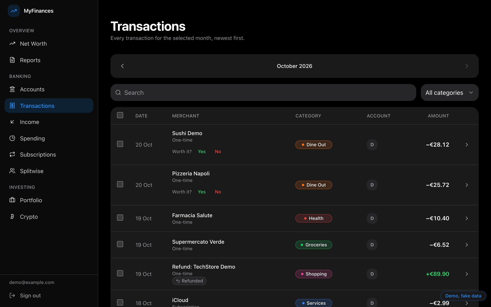
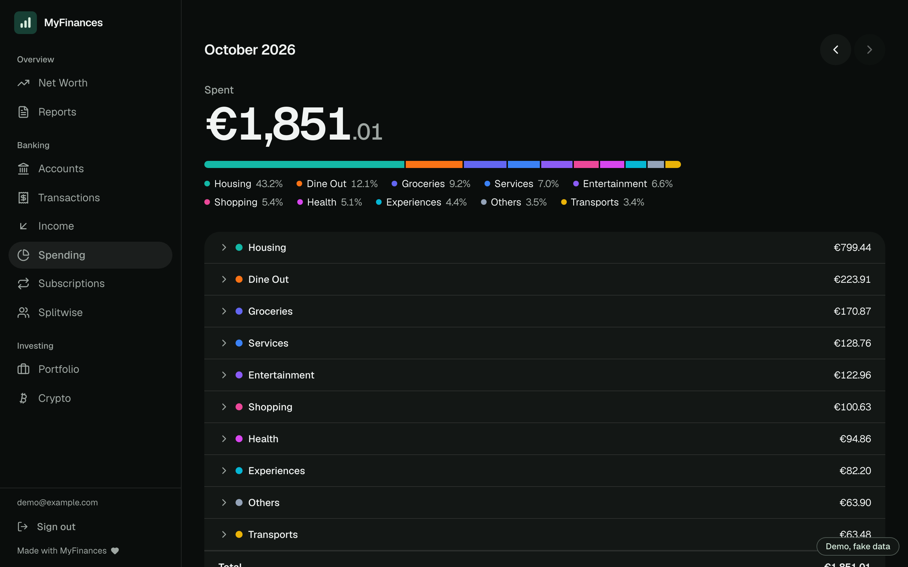
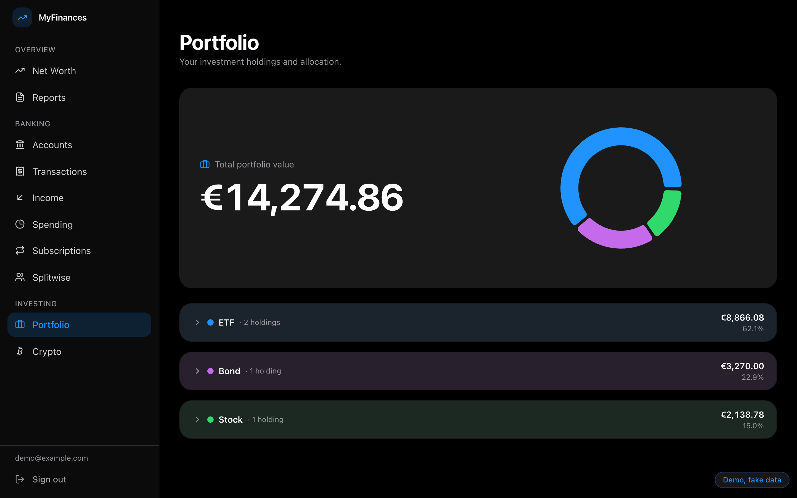
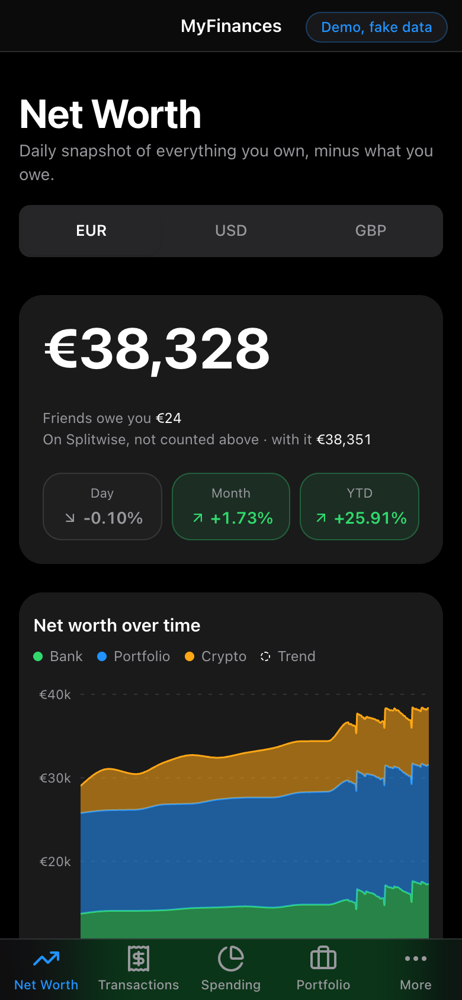

# My Wealth View

A self-hosted net worth dashboard. Bank accounts, investments and crypto in one place, converted to a single currency.

**[Try the live demo →](https://myfinancess-view.vercel.app/demo)** No sign-up. The demo runs on generated fake data inside your browser and never touches a real account. The data follows today's date, so the latest transactions are always from today or yesterday.



| Transactions                                       | Spending                                               | Portfolio                                    | Phone                                        |
| -------------------------------------------------- | ------------------------------------------------------ | -------------------------------------------- | -------------------------------------------- |
|  |  |  |  |

- **Net Worth**: total over time (bank + portfolio + crypto), in EUR, USD or GBP
- **Transactions**: full register with inline categories and a "worth it?" check
- **Subscriptions**: recurring charges with detected billing frequency and true monthly cost; one-off charges are listed separately and left out of the estimate
- **Spending** and **Income vs Expenses**: monthly breakdowns
- **Portfolio** and **Crypto**: holdings, allocation and live-priced value

This is the frontend. The data pipeline (bank sync, FX rates, AI categorization, pricing, setup wizard) is in [myfinances](https://github.com/marcodonghiaa/myfinances). Start there to self-host.

## Look and feel

Number-first design in the spirit of Trade Republic and Revolut:
- Each screen opens on one exact figure, set in Geist with tabular numbers.
- Scrub the net-worth chart to read any past day.
- Lists use rounded pills and hairline rows.
- Brand forest is the only control colour (mint in dark mode).
- Phones get a bottom tab bar.
- Light and dark themes follow the system setting (no toggle). Account numbers are masked until tapped, charts carry text alternatives, and translucency falls back to solid when the OS asks for reduced transparency.

## Stack

TanStack Start (React), TypeScript, Tailwind, shadcn/ui, Recharts, Supabase, Vitest, deployed on Vercel. The app only uses the publishable key, so every read and write goes through Row Level Security (`auth.uid() = user_id`). No service-role key is used anywhere.

## Self-host it

Start from the backend: [myfinances → Getting started](https://github.com/marcodonghiaa/myfinances#-getting-started). Its `setup.sh` creates the Supabase project, can run the sync on GitHub Actions, and prints the three values the dashboard needs. About 30 minutes the first time, nothing to install if you use Codespaces.

Then put the dashboard online:

[](https://vercel.com/new/clone?repository-url=https%3A%2F%2Fgithub.com%2Fmarcodonghiaa%2Fmy-wealth-view&project-name=my-finances&repository-name=my-finances&env=VITE_SUPABASE_URL%2CVITE_SUPABASE_PUBLISHABLE_KEY%2CVITE_VAPID_PUBLIC_KEY&envDescription=Printed+at+the+end+of+the+backend%27s+setup.sh&envLink=https%3A%2F%2Fgithub.com%2Fmarcodonghiaa%2Fmyfinances%23-getting-started)

Vercel copies this repo to your GitHub, asks for `VITE_SUPABASE_URL`, `VITE_SUPABASE_PUBLISHABLE_KEY` and `VITE_VAPID_PUBLIC_KEY` (paste the values setup printed) and gives you an HTTPS address. Run the backend's `./setup.sh` once more with that address, so bank linking sends you back to it. Free on Vercel's Hobby plan; phone and push notifications work because it is HTTPS.

Prefer your own server? `docker compose` in the backend repo runs both apps instead.

## Develop

Needs [Bun](https://bun.sh) and a `.env` (written by the backend's `setup.sh`, or `cp .env.example .env` and fill in your Supabase URL and publishable key).

```sh
bun install
bun run dev
```

Set your own `.env`: in a browser on a self-hosted domain the app throws rather than silently connecting to the maintainer's Supabase project.

## Import your history

Open **Import data** (a link on the Accounts page, also offered on a new empty dashboard). Pick net worth by month or spending by month, then choose a CSV: in Excel, File → Save As → CSV. The file is read in your browser and nothing is sent until you press Import.

- Amounts are read as EUR. Spending rows in another currency are skipped.
- Months can be `2024-03`, `03/2024`, `Mar 2024`, `marzo 2024` or an Excel date. Day-first dates (`03/04/2024` is 3 April) are assumed.
- Importing again overwrites months that already exist. Undo removes the rows of that import but does not bring back values it replaced.
- Examples: [`docs/examples/net-worth.csv`](docs/examples/net-worth.csv) and [`docs/examples/spending.csv`](docs/examples/spending.csv).

## Deploy on Vercel

Use the Deploy button above, or import the repo in Vercel yourself (framework: Other, defaults for build). Vercel sets `VERCEL=1`, which switches the Nitro preset to `vercel` in `vite.config.ts`. Add `VITE_SUPABASE_URL`, `VITE_SUPABASE_PUBLISHABLE_KEY` (and `VITE_VAPID_PUBLIC_KEY` for push) as environment variables, then add the Vercel domain under Supabase → Authentication → URL Configuration so login redirects work. Every merge to `main` deploys; every PR gets a preview URL.

## Scripts

`bun run dev` · `bun run build` · `bun run test` · `bun run lint` · `bun run format`

## Support

If MyFinances is useful to you, a ⭐ on [GitHub](https://github.com/marcodonghiaa/my-wealth-view) helps others find it. The app shows a small "Made with MyFinances" credit in its menu; set `VITE_HIDE_BRANDING=true` to hide it.

## License

[MIT](LICENSE)
